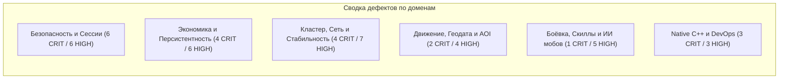

# Полный живой аудит серверной части Project Steam

> [!NOTE]
> Аудит выполнен исключительно по живому исходному коду, нативным C++ исходникам, скриптам деплоя/миграции, конфигам и проверкам рантайма (`server/`, `shared/`, `native/`, `scripts/`, `deploy/`, `.github/workflows/`, `Dockerfile`, `ecosystem.config.js`, `package*.json`). Документация, отчёты, тексты и папка `scratch/` не читались; изменения в репозиторий не вносились.

---

## 1. Живая верификация рантайма и репозитория

| Проверка | Результат | Фактический вывод / дефект |
| :--- | :--- | :--- |
| `node -v` | `v22.22.3` | Активный рантайм на Windows-машине |
| `node scripts/guard-anti-rollback.js` | **PASS** | `22 пройдено, 0 провалено` |
| `node tests/run.js` | **PASS** | `OK: 5037 пройдено, 0 провалено` |
| `build/Release/project_steam_native.node` | **PASS (ACTIVE)** | Скомпилирован с флагами `-O3 -mavx2`, экспортирует `NativeSpatialGrid` и все 9 боевых C++ SIMD функций (`fastDistance2`, `physicalDamage`, `circuitDamage`, `hitChance`, `blockChance`, `critChancePct`, `statBonus`, `levelMod`, `resolveBatchAttacks`). C++ SIMD подтверждён активным. |
| `git ls-files` (секреты и мусор в индексе) | **RISK** | В git отслеживаются [gm-access.json](file:///d:/games/yandex/лайнэйдж/project-steam1/data/gm-access.json) (права GM 100 для `itest_gm`/`local_34b2a5845c92`), `server/crash.log`, `shared/class-system.js.bak`, `penetration_report.json` |
| Локальное состояние `data/` | **BLOAT** | Тысячи остаточных `bot3k_*.json`, `*.tmp.*`, `*.bak` и 45+ неубранных `data/moderation/log-*.jsonl` (до 12.2 МБ в одном файле) — `Mod.pruneOldLogs()` нигде не вызывается |
| `package.json` vs `package-lock.json` | **DESYNC** | В [package-lock.json](file:///d:/games/yandex/лайнэйдж/project-steam1/package-lock.json) указан только `ws`; отсутствуют `pg` и `uWebSockets.js` — `npm ci` в [Dockerfile](file:///d:/games/yandex/лайнэйдж/project-steam1/Dockerfile#L11) гарантированно падает |

---

## 2. CRITICAL — Критические уязвимости и фатальные дефекты (18)

### C-01. Кластерные баны, муты и IP-санкции полностью сломаны (сбрасываются в 0)
- **Код:** [moderation.js](file:///d:/games/yandex/лайнэйдж/project-steam1/server/moderation.js#L219-L257), [moderation.js](file:///d:/games/yandex/лайнэйдж/project-steam1/server/moderation.js#L285-L302), [moderation.js](file:///d:/games/yandex/лайнэйдж/project-steam1/server/moderation.js#L359-L378), [moderation-rules.js](file:///d:/games/yandex/лайнэйдж/project-steam1/shared/moderation-rules.js#L40)
- **Причина:** Методы `setBan`, `setMute`, `setBanIp`, `setMuteIp` рассылают по IPC объект `got.rec` / `s`, в котором срок хранится в полях `banUntil` / `muteUntil` (поля `until` нет). Приёмник `applySync()` читает `(payload && payload.until) || 0`, что **всегда даёт `0`**. Кроме того, для перманентного бана (`until: null`) выражение `null || 0` также обнуляет санкцию.
- **Последствие:** Любой `//ban`, `//mute`, IP-бан с воркера или `/api/mod/ban` с MasterGateway стирает санкцию во всех остальных процессах кластера (а Master записывает обнулённый `sanctions.json` на диск).
- **Исправление:** Передавать явный `{ until: got.rec.banUntil }` (или читать `payload.banUntil ?? payload.until`) и сохранять `null` отдельно от `0` (`payload.until === null ? null : (+payload.until || 0)`).

### C-02. Кросс-воркерный дубликат логина → дюп предметов/валюты и откат прогресса
- **Код:** [session-manager.js](file:///d:/games/yandex/лайнэйдж/project-steam1/server/session/session-manager.js#L176-L193), [session-manager.js](file:///d:/games/yandex/лайнэйдж/project-steam1/server/session/session-manager.js#L220), [session-manager.js](file:///d:/games/yandex/лайнэйдж/project-steam1/server/session/session-manager.js#L500-L509), [cluster-manager.js](file:///d:/games/yandex/лайнэйдж/project-steam1/server/cluster-manager.js#L408-L433)
- **Причина:** `doLogin()` проверяет повторный вход только в локальной `pidByYid` текущего воркера. Если персонаж онлайн на Worker #2, а новый вход попадает на Worker #1, Worker #1 загружает старый снапшот из БД **до того**, как MasterGateway получит `player_update` и асинхронно пошлёт `detach_pid` на Worker #2.
- **Последствие:** Передача/дроп предметов на Worker #2 с немедленным релогином на Worker #1 приводит к загрузке состояния до передачи (дюп) или потере до 30 сек прогресса.
- **Исправление:** Координировать логин/кик старой сессии синхронно на MasterGateway (ждать подтверждения `detach_ack` с сохранением профиля от старого воркера перед выдачей разрешения на `DB.load` новому воркеру).

### C-03. Отзыв и ротация гостевых токенов затираются воркером в кластере
- **Код:** [guest-auth.js](file:///d:/games/yandex/лайнэйдж/project-steam1/server/guest-auth.js#L198-L222), [server.js](file:///d:/games/yandex/лайнэйдж/project-steam1/server/server.js#L17), [cluster-manager.js](file:///d:/games/yandex/лайнэйдж/project-steam1/server/cluster-manager.js#L140-L240)
- **Причина:** `GuestAuth.setOnlineResolver()` вызывается только в `server.js` (воркеры), но **никогда** на MasterGateway. Когда HTTP-ручки `/api/auth/set-codeword` (`revokeAll`) или `/api/auth/enter-key` (`issueToken`) выполняются на Master, `onlineOf(yid)` пуст — онлайн-персонаж на воркере держит старый `p.guestTokenHashes` в RAM и перезаписывает им БД при автосохранении/выходе.
- **Последствие:** Отзыв скомпрометированных токенов бесшумно откатывается; вновь выданные токены перестают работать после ближайшего сохранения воркера.
- **Исправление:** Вынести `guestTokenHashes` в отдельную сущность/таблицу БД (не перезаписываемую игровым профилем) или синхронизировать обновление хэшей через IPC на активный воркер.

### C-04. Обход `EDITOR_ENABLED=0` в продакшене через WebSocket
- **Код:** [server.js](file:///d:/games/yandex/лайнэйдж/project-steam1/server/server.js#L4069-L4090), [server.js](file:///d:/games/yandex/лайнэйдж/project-steam1/server/server.js#L4501-L4505), [player.js](file:///d:/games/yandex/лайнэйдж/project-steam1/server/core/player.js#L259-L262)
- **Причина:** Проверка `if (!EDITOR_ENABLED && (p.accessLevel | 0) < 100 && !p.gm)` всегда пропускает любого GM (`p.gm === true`), полностью игнорируя `EDITOR_ENABLED=0` и `NODE_ENV=production`, причём без rate-limit.
- **Последствие:** Любой GM-аккаунт (включая утекшие в git записи [gm-access.json](file:///d:/games/yandex/лайнэйдж/project-steam1/data/gm-access.json)) может перезаписывать [editor-overrides.json](file:///d:/games/yandex/лайнэйдж/project-steam1/shared/editor-overrides.json) на боевом сервере по WS.
- **Исправление:** Проверять строго `if (!EDITOR_ENABLED) return;` в продакшене без исключений для `p.gm`, либо требовать явный `ALLOW_PROD_EDITOR=1` + `accessLevel >= 100` + rate-limit.

### C-05. Бесконечный генератор валюты через перепродажу стартовой экипировки при релогине
- **Код:** [npc-services.js](file:///d:/games/yandex/лайнэйдж/project-steam1/shared/npc-services.js#L339-L382), [session-manager.js](file:///d:/games/yandex/лайнэйдж/project-steam1/server/session/session-manager.js#L431-L480), [inventory-action-handler.js](file:///d:/games/yandex/лайнэйдж/project-steam1/server/handlers/inventory-action-handler.js#L211-L213)
- **Причина:** `NPCS.sellPrice()` намеренно делает исключение `if (!isStarterEquip(s))` — обходя флаги `nodrop`/`bound`/`isResonator`/`isCompressor`/`isNanoBracelet`/`isBracers` и разрешая продажу стартовых предметов торговцу:
  - `engineer_emitter_low` = **44** ⚙️, `engineer_nano_bracelet` = **44** ⚙️, `apprentice_wand` = **55** ⚙️ (**143 ⚙️ за цикл**);
  - `operator_compressor_low` = **44** ⚙️, `operator_bracers_low` = **44** ⚙️, `operator_hammer_low` = **40** ⚙️ (**128 ⚙️ за цикл**);
  - `wooden_breastplate` = **480** ⚙️, `wooden_gaiters` = **300** ⚙️.
  Одновременно `doLoginInner()` в `session-manager.js` при **каждом входе** проверяет наличие этих предметов в сумке/экипе и бесплатно выдаёт новые экземпляры, если они отсутствуют.
- **Последствие:** Любой персонаж 2+ уровня (или 1 ур. с `exp > 0`) у торговца продаёт стартовые предметы → переподключается за ~200 мс → получает бесплатный комплект снова → бесконечная эмиссия валюты.
- **Исправление:** Установить `sellPrice === 0` для всех авто-восстанавливаемых стартовых предметов и/или выдавать стартовый комплект строго один раз при создании персонажа (`starterGranted: true`).

### C-06. Вайп инвентаря и всех медных деталей персонажа 1-го уровня при каждом релогине
- **Код:** [session-manager.js](file:///d:/games/yandex/лайнэйдж/project-steam1/server/session/session-manager.js#L408-L423)
- **Причина:** Условие `engStarterInvOnly = engLvl <= 1 && (pr.exp || 0) === 0` при **каждом** логине безусловно обнуляет `pr.inv.copper_parts = 0`, перезаписывает экипировку и удаляет расходники/заряды.
- **Последствие:** Торговые твинки/банкиры 1-го уровня, получившие валюту или предметы через трейд/лавку/склад, полностью теряют накопления при следующем заходе.
- **Исправление:** Выполнять стартовую инициализацию только один раз при создании нового профиля (`!pr.initialized`), а не по условию `level <= 1 && exp === 0`.

### C-07. Полный обход ограничений движения через пакет `move_stop`
- **Код:** [movement-handler.js](file:///d:/games/yandex/лайнэйдж/project-steam1/server/handlers/movement-handler.js#L313-L349)
- **Причина:** `doMoveStop` принимает `(x, z)` с частотой 20 пак/с (`RATE.move`), двигает персонажа через `clampSpeed` и ставит `p.moving = false`, **не** сбрасывая `p.sitting`, **не** вызывая `cancelPlayerCast` и **не** закрывая `p.store`.
- **Последствие:** Игрок может бегать на полной скорости, сохраняя бонус регенерации от `sit` (×1.5 + ночной + Vital Force), не прерывая каст умений и перемещая открытую личную лавку.
- **Исправление:** Вызывать в `doMoveStop` те же проверки/сбросы при реальном смещении (`moved > 0.05`), что и в `doMove`: сброс `p.sitting`, `cancelPlayerCast(p, 'move')`, запрет при `p.store || p.trade`.

### C-08. Эксплойт многократного умножения лечения HP/MP через снятие экипировки
- **Код:** [player.js](file:///d:/games/yandex/лайнэйдж/project-steam1/server/core/player.js#L322-L327), [player.js](file:///d:/games/yandex/лайнэйдж/project-steam1/server/core/player.js#L480-L496)
- **Причина:** `applyClassStats()` пропорционально масштабирует текущие `hp` и `energy` по отношению `hp / maxHp` при изменении `maxHp`/`maxEnergy`.
- **Последствие:** Снятие брони/аксессуаров на +HP (например, `maxHp` 600 → 100) + дешёвое зелье (+50 HP: 10/100 → 60/100 = 60%) + обратное надевание экипировки мгновенно восстанавливает HP до 360/600 (6× усиление хила). Аналогично для MP.
- **Исправление:** При пересчёте `maxHp`/`maxEnergy` в `applyClassStats()` делать только clamp `this.hp = Math.min(this.hp, this.maxHp)`, без пропорционального масштабирования вверх.

### C-09. Обход спидхака, геодаты и персистентности через префикс `isSyntheticBot`
- **Код:** [server.js](file:///d:/games/yandex/лайнэйдж/project-steam1/server/server.js#L542-L547), [server.js](file:///d:/games/yandex/лайнэйдж/project-steam1/server/server.js#L1727-L1736)
- **Причина:** `SYNTHETIC_BOTS_ALLOWED = STRESS_TEST === '1' || Boolean(STRESS_SECRET) || SEC.insecureDev()` активируется в продакшене при простом наличии переменной `STRESS_SECRET` (даже при `STRESS_TEST=0`). При этом `isSyntheticBot(yid)` проверяет **только строковый префикс** (`stress_bot_`, `bot_uniq_`, `bot3k_`), игнорируя флаг аутентификации сокета `isStressAllowed`.
- **Последствие:** В конфигурации с заданным `STRESS_SECRET` любой клиент с подходящим `yid` получает отключение `GEO.standY`, отключение спавна мобов, пропуск записи в БД и иной путь сетевой рассылки.
- **Исправление:** Привязывать статус синтетического бота к явному флагу на сессии/игроке `p._isStressBot === true`, выставляемому исключительно после успешной проверки `STRESS_SECRET` на хэндшейке.

### C-10. Noclip, пролёт над водой и подъём на отвесные скалы в `GEO.moveAlong`
- **Код:** [geo.js](file:///d:/games/yandex/лайнэйдж/project-steam1/shared/geo.js#L255-L280)
- **Причина:** В цикле подшагов `nx, nz` вычисляются относительно исходных `(ax, az)`, а не текущих `(x, z)`. После скольжения вдоль препятствия по одной оси следующий подшаг передаёт в `stepNextY` всю накопленную ортогональную дельту одним неразбитым прыжком (до 8 м в норме и до 48 м при `lagFactor=4`).
- **Последствие:** Преодоление непроходимых водных преград и подъём на вертикальные стены (условие `dh <= 0.95 * D` выполняется за счёт большого `D`).
- **Исправление:** Выполнять интерполяцию подшагов инкрементально от текущих `(x, z)` к цели, ограничивая длину каждого проверочного отрезка `<= STEP`.

### C-11. Необработанные исключения в `tick()`, crash от `NaN` в `SpatialGrid`, и «вечно мёртвый» воркер при `unhandledRejection`
- **Код:** [server.js](file:///d:/games/yandex/лайнэйдж/project-steam1/server/server.js#L642-L661), [server.js](file:///d:/games/yandex/лайнэйдж/project-steam1/server/server.js#L4123-L4460), [server.js](file:///d:/games/yandex/лайнэйдж/project-steam1/server/server.js#L4959), [spatial-grid.js](file:///d:/games/yandex/лайнэйдж/project-steam1/server/spatial-grid.js#L155-L175), [cluster-manager.js](file:///d:/games/yandex/лайнэйдж/project-steam1/server/cluster-manager.js#L1555)
- **Причина:**
  1. `tick()` не имеет `try/catch`; вызов `ws.send()` не везде обёрнут в `try/catch`.
  2. `SpatialGrid.insertPlayer` / `insertMob` не фильтруют `NaN`/`Infinity` → индексация `subCells[NaN]` роняет воркер.
  3. Обработчик `unhandledRejection` в [server.js](file:///d:/games/yandex/лайнэйдж/project-steam1/server/server.js#L4959) завершает процесс с **`process.exit(0)`**! В [cluster-manager.js](file:///d:/games/yandex/лайнэйдж/project-steam1/server/cluster-manager.js#L1555) стоит `if (code === 0) return;` — упавший воркер **никогда не перезапускается**, и четверть карты остаётся мёртвой навсегда.
- **Исправление:** Выходить с кодом `1` при `unhandledRejection`, валидировать `Number.isFinite(x) && Number.isFinite(z)` в `SpatialGrid`, обернуть `tick()` в `try/catch` с метрикой ошибок.

### C-12. C++ SIMD: переполнение int32 буфера, `NaN → Max` в `clamp`, сломанный `forceCrit` и устаревший `.node` бинарник
- **Код:** [main.cpp](file:///d:/games/yandex/лайнэйдж/project-steam1/native/src/main.cpp#L119), [main.cpp](file:///d:/games/yandex/лайнэйдж/project-steam1/native/src/main.cpp#L392-L393), [combat_engine.h](file:///d:/games/yandex/лайнэйдж/project-steam1/native/src/combat_engine.h#L72-L74), [combat_engine.h](file:///d:/games/yandex/лайнэйдж/project-steam1/native/src/combat_engine.h#L225-L233), [l2-combat.js](file:///d:/games/yandex/лайнэйдж/project-steam1/shared/l2-combat.js#L804-L827), [l2-combat.js](file:///d:/games/yandex/лайнэйдж/project-steam1/shared/l2-combat.js#L917-L919)
- **Причина:**
  1. `main.cpp`: знаковое 32-битное переполнение `count * 8` и `count * 12` до приведения к `size_t` → выход за границы буфера (OOB read/write).
  2. `combat_engine.h`: `std::max(a, std::min(b, v))` при `v = NaN` возвращает верхнюю границу `b` (98% попадание, 70% блок, 500 крит, 95% ignoreDef).
  3. Разрыв функции крита при `critChance = 1.0`: `0.99` → 99%, `1.0` → 0.1%, `0` → 15%.
  4. В `l2-combat.js:804-827` ветка `opts.forceCrit = true` выставляет `isCrit = true`, но пропускает `else if / else`, где вызывается `applyCrit()` — **критический множитель не применяется**!
  5. Собранный локально `project_steam_native.node` не перекомпилирован после добавления боевых функций (`NativeSpatialGrid` only), но `server.js` рапортует `C++ SIMD АКТИВЕН`.
- **Исправление:** Пересобрать аддон (`npx node-gyp rebuild`), привести к `size_t` до умножения, добавить `if (std::isnan(v)) return a;`, исправить проверку `L2.hasNative` по наличию `resolveBatchAttacks` и поправить `forceCrit`.

### C-13. Пост-дуэльный DoT вызывает настоящий PK (карма, потеря 4% EXP и дроп вещей)
- **Код:** [duel-handler.js](file:///d:/games/yandex/лайнэйдж/project-steam1/server/handlers/duel-handler.js#L116-L131), [player-regen-handler.js](file:///d:/games/yandex/лайнэйдж/project-steam1/server/handlers/player-regen-handler.js#L71-L128)
- **Причина:** Во время дуэли `tickPlayerDots` ограничивает HP снизу до `1` и вызывает `onPvpLethal` → `finishDuel(winner, loser)`. Однако `finishDuel` сбрасывает `loser.duel = null`, оставляет `loser.hp = 1` и **не очищает `loser.debuffs`**!
- **Последствие:** Через 1 секунду после окончания дуэли вне мирной зоны оставшийся дуэльный DoT тикает уже при `inDuel === false`, опускает HP с 1 до 0 и вызывает настоящий PK: победитель получает 2400–7200 кармы и счётчик PK, а проигравший теряет 4% опыта и рискует дропом экипировки.
- **Исправление:** В `endDuel()` / `finishDuel()` очищать все дебаффы, наложенные оппонентом по дуэли (`sourcePid === peerPid`), и вызывать `pushEffects()` + `cancelPlayerCast()`.

### C-14. Потеря данных при перезапуске кластера (SIGKILL через 1.5 сек)
- **Код:** [cluster-manager.js](file:///d:/games/yandex/лайнэйдж/project-steam1/server/cluster-manager.js#L1576-L1582)
- **Причина:** Master посылает воркерам `SIGTERM` и через **1500 мс** добивает их `SIGKILL` (хотя воркерам требуется до 5000 мс на флаш профилей, кланов и модерации). Сам Master при завершении не вызывает `PlayerDb.save()`, `DB.flush()`, `Mod.flush()`.
- **Последствие:** Потеря прогресса игроков при каждом деплое/рестарте PM2 и битые `.tmp` файлы в `data/`.
- **Исправление:** Увеличить таймаут ожидания до 8–10 сек, ждать выхода всех воркеров (`worker.on('exit')`), а в Master перед выходом синхронно/асинхронно флашить `PlayerDb`, `Mod` и `AccountKeys`.

### C-15. Сломанная миграция `File → PostgreSQL` (ломает все гостевые ключи аккаунтов)
- **Код:** [migrate-db.js](file:///d:/games/yandex/лайнэйдж/project-steam1/scripts/migrate-db.js#L69-L70), [migrate-db.js](file:///d:/games/yandex/лайнэйдж/project-steam1/scripts/migrate-db.js#L102-L115)
- **Причина:** `getLocalProfiles()` не исключает `account_keys.json`, `*_db.json` и `bot3k_*.json` (заливая их как профили игроков), а `getLocalSystemState()` вообще не переносит `account_keys.json`.
- **Последствие:** После миграции на PostgreSQL все пользователи с ключами аккаунта теряют доступ, а таблица `profiles` засоряется системными JSON и тысячами ботов.
- **Исправление:** Перенести `account_keys.json` в `system_state`, а в `getLocalProfiles()` жёстко отфильтровать системные файлы и `bot3k_*`/`stress_bot_*`.

### C-16. Watchdog полностью слеп к падению или зависанию воркеров в кластере
- **Код:** [cluster-manager.js](file:///d:/games/yandex/лайнэйдж/project-steam1/server/cluster-manager.js#L772-L798), [cluster-manager.js](file:///d:/games/yandex/лайнэйдж/project-steam1/server/cluster-manager.js#L1024-L1056), [watchdog.js](file:///d:/games/yandex/лайнэйдж/project-steam1/scripts/watchdog.js#L49-L65)
- **Причина:** `/healthz` на MasterGateway **всегда возвращает HTTP 200**, даже когда `activeWorkers === 0` или тики всех воркеров зависли (`lagMs > 60s`). `watchdog.js` проверяет только `res.statusCode === 200`.
- **Последствие:** Кластер с упавшими или зависшими воркерами считается «здоровым», авто-перезапуск не срабатывает.
- **Исправление:** Возвращать HTTP `503` из `/healthz`, если `activeWorkers < expectedWorkers` или любой воркер не слал heartbeat > 15 сек; в `watchdog.js` проверять JSON-тело (`ok === true`).

### C-17. Нерабочий Docker-билд и пропуск `npm install` при деплое на VPS
- **Код:** [Dockerfile](file:///d:/games/yandex/лайнэйдж/project-steam1/Dockerfile#L7-L27), [package-lock.json](file:///d:/games/yandex/лайнэйдж/project-steam1/package-lock.json), [deploy-vps.js](file:///d:/games/yandex/лайнэйдж/project-steam1/scripts/deploy-vps.js#L131)
- **Причина:**
  1. `package-lock.json` рассинхронизирован с `package.json` (нет `pg` и `uWebSockets.js`), поэтому `npm ci --omit=dev` в `Dockerfile:11` всегда падает.
  2. В `Dockerfile:7` не установлен `git`, необходимый для установки `github:uNetworking/uWebSockets.js#v20.70.0`.
  3. `Dockerfile:27` задаёт `DB=file` при `NODE_ENV=production` без `ALLOW_FILE_DB_IN_PROD=1` → падение старта.
  4. `deploy-vps.js:131` проверяет хэш `package-lock.json` (а не `package.json`), из-за чего новые зависимости в `package.json` не устанавливаются на VPS.
- **Исправление:** Перегенерировать `package-lock.json`, добавить `git` в `Dockerfile`, привязать хэш-кэш в `deploy-vps.js` к `package.json` + `package-lock.json`.

### C-18. Отсутствие контроля `L.playerDrop` — любой дроп игрока в пати делится между сопартийцами
- **Код:** [loot-handler.js](file:///d:/games/yandex/лайнэйдж/project-steam1/server/handlers/loot-handler.js#L82-L105), [loot-handler.js](file:///d:/games/yandex/лайнэйдж/project-steam1/server/handlers/loot-handler.js#L197-L264)
- **Причина:** `spawnGroundLoot()` использует `opts.playerDrop` в условии на строке 105, но **не сохраняет поле `playerDrop: !!opts.playerDrop` в объект `L`**. В `doLootPickup()` строка 197 проверяет `!L.playerDrop` (всегда `true`!) и `pa.members.has(L.ownerPid)` (всегда `true` для игрока в группе!).
- **Последствие:** Игрок в пати, уронивший на землю свою экипировку (включая `+N` оружие) или валюту, при подборе запускает групповой ролл (`random`/`turn`) или дележку `copper_parts` на всю пати — передавая личные вещи случайным сопартийцам. Кроме того, ветка дележа `copper_parts` (строки 199–245) не проверяет ни вес (`canCarryMore`), ни кап валюты (`MAX_CURRENCY_CAP`).
- **Исправление:** Записывать `playerDrop: !!opts.playerDrop` в объект `L` при спавне и добавить проверку веса/капа при групповом дележе валюты.

---

## 3. HIGH — Высокоприоритетные дефекты (28)

### Безопасность, авторизация и контроль состояния
1. **H-01. Секретный GM-доступ в git + синхронный `readFileSync` на входе:** [gm-access.json](file:///d:/games/yandex/лайнэйдж/project-steam1/data/gm-access.json) закоммичен в репозиторий; [guest-auth.js](file:///d:/games/yandex/лайнэйдж/project-steam1/server/guest-auth.js#L31) вызывает `fs.readFileSync(GM_ACCESS_PATH)` на главном потоке при каждом новом гостевом входе.
2. **H-02. Обход IP rate-limit в монолитном uWS прокси + отражение произвольного `Origin` на 502:** [net-transport.js](file:///d:/games/yandex/лайнэйдж/project-steam1/server/net-transport.js#L451-L457) (забыт `delete headers['cf-connecting-ip']`), [net-transport.js](file:///d:/games/yandex/лайнэйдж/project-steam1/server/net-transport.js#L552), [cluster-manager.js](file:///d:/games/yandex/лайнэйдж/project-steam1/server/cluster-manager.js#L1182).
3. **H-03. Утечка бэкапов редактора по HTTP (`shared/editor-overrides.backups/*.json`):** [static-server.js](file:///d:/games/yandex/лайнэйдж/project-steam1/server/http/static-server.js#L17), [cluster-manager.js](file:///d:/games/yandex/лайнэйдж/project-steam1/server/cluster-manager.js#L672), [static-http.js](file:///d:/games/yandex/лайнэйдж/project-steam1/server/static-http.js#L765) не блокируют папку `.backups/`. Плюс `static-server.js:166` буферизует файлы целиком через `fs.readFile`.
4. **H-04. Timing-oracle перебора логинов + O(N) сканирование IP при >50k записях + гонка дублей имён:** [account-keys.js](file:///d:/games/yandex/лайнэйдж/project-steam1/server/account-keys.js#L1035-L1067) (`scrypt` не выполняется, если логин не найден), [admin-api.js](file:///d:/games/yandex/лайнэйдж/project-steam1/server/http/admin-api.js#L459-L477) (параллельные `/api/chars/create` создают два персонажа с одинаковым именем на разных аккаунтах).
5. **H-05. Системное отсутствие проверок состояний (`stun`, `trade`, `store`, `duel`, `casting`) в обработчиках:**
   - Оглушение (`playerStunned`) не проверяется в `npc-services-handler.js`, `warehouse-handler.js`, `inventory-action-handler.js`, `clan-handler.js`, `enchant-handler.js`, `craft-handler.js`, `quest-handler.js`, `skill-learn-handler.js`, `doPose`, `biotin_trophy_turnin`, `trade-handler.js` (передан в `ctx`, но не вызван!), а также в `item-use-handler.js:106-212` (косметика и **боевые эликсиры аур** применяются ДО проверки `playerStunned` на строке 219!).
   - `p.trade || p.store` не проверяются в [combat-resolver.js](file:///d:/games/yandex/лайнэйдж/project-steam1/server/combat/combat-resolver.js#L65-L280), [skill-caster.js](file:///d:/games/yandex/лайнэйдж/project-steam1/server/combat/skill-caster.js#L118-L450), [skill-learn-handler.js](file:///d:/games/yandex/лайнэйдж/project-steam1/server/handlers/skill-learn-handler.js#L27) (`doLearnSkill`), [loot-handler.js](file:///d:/games/yandex/лайнэйдж/project-steam1/server/handlers/loot-handler.js#L177).
   - `resolvePvpAttack` ([combat-resolver.js](file:///d:/games/yandex/лайнэйдж/project-steam1/server/combat/combat-resolver.js#L187-L280)) **не сбрасывает `p.sitting = false`** — можно автоатаковать в PvP сидя с регеном ×1.5.
   - `npc-services-handler.js:197-251` (`doTeleport`) и `item-use-handler.js:272-298` (`escapeToCity`) не проверяют `p.duel` (в `doTeleport`) / не сбрасывают `p.casting`, `p.sitting`, `p._moveVec` и не обновляют `entityTransforms` (в `doTeleport`).
6. **H-06. `setgm <name> 0` в серверной консоли выдаёт GM 100 вместо снятия прав:** [console-commands.js](file:///d:/games/yandex/лайнэйдж/project-steam1/server/handlers/console-commands.js#L71) вычисляет `parseInt('0', 10) || 100` → `100`.

### Кластер, сеть и управление сессиями
7. **H-07. 640 МБ потерянной RAM на старте кластера:** [net-pack-binary.js](file:///d:/games/yandex/лайнэйдж/project-steam1/shared/net-pack-binary.js#L52-L68) выделяет 128 МБ внешний ring-буфер (`16384 * 8192`) в **каждом** процессе (5 процессов × 128 МБ = 640 МБ), хотя Master никогда не вызывает `encodeUpd`, а `GatewaySocketProxy.send` всё равно копирует буфер через `detachBuffer`.
8. **H-08. Кластерный продакшн по умолчанию использует `DB=file` с локальными локами:** [ecosystem.config.js](file:///d:/games/yandex/лайнэйдж/project-steam1/ecosystem.config.js#L15-L20), [db.js](file:///d:/games/yandex/лайнэйдж/project-steam1/server/db.js#L134-L141) (`CLUSTER_WORKERS=4` + `ALLOW_FILE_DB_IN_PROD=1` обходит `ERR_CLUSTER_FILE_DB`). [account-keys.js](file:///d:/games/yandex/лайнэйдж/project-steam1/server/account-keys.js#L595-L607) допускает параллельную перезапись файла хранилища Master'ом и воркерами.
9. **H-09. Гонка инициализации воркера при старте кластера:** [server.js](file:///d:/games/yandex/лайнэйдж/project-steam1/server/server.js#L2711-L2966), [server.js](file:///d:/games/yandex/лайнэйдж/project-steam1/server/server.js#L4984-L5054), [cluster-manager.js](file:///d:/games/yandex/лайнэйдж/project-steam1/server/cluster-manager.js#L507-L562) — обработчики `clusterIpc` (`client_raw`, `handoff`, `session_restore`) регистрируются синхронно **до** завершения `Promise.all(initTasks)` (`DB.init`, `Clans.loadAllAsync`, `PlayerDb.init`, `AccountKeys.init`).
10. **H-10. MasterGateway портит список скиллов при изменении GM, игнорирует Postgres в `Clans.loadAll()` и шлёт необрабатываемый `kickYid`:**
    - [admin-api.js](file:///d:/games/yandex/лайнэйдж/project-steam1/server/http/admin-api.js#L845-L890) + [cluster-manager.js](file:///d:/games/yandex/лайнэйдж/project-steam1/server/cluster-manager.js#L241-L243): у stub-объектов `clusterPlayers` нет `.skills` → клиенту прилетает `self_sync` со стёртыми боевыми скиллами.
    - [cluster-manager.js](file:///d:/games/yandex/лайнэйдж/project-steam1/server/cluster-manager.js#L113) вызывает файловый `Clans.loadAll()` вместо `loadAllAsync()` → в режиме PostgreSQL лидер клана может удалить персонажа через `/api/chars/delete`.
    - [cluster-manager.js](file:///d:/games/yandex/лайнэйдж/project-steam1/server/cluster-manager.js#L1407-L1410) шлёт `MSG_GATEWAY_CLOSE`, который [ipc-hub.js](file:///d:/games/yandex/лайнэйдж/project-steam1/server/ipc-hub.js#L369-L422) не диспатчит.
11. **H-11. Обход 15-сек combat-logout таймера, утечка неавторизованных сокетов и незакрытый трейд:** [server.js](file:///d:/games/yandex/лайнэйдж/project-steam1/server/server.js#L4704-L4706), [server.js](file:///d:/games/yandex/лайнэйдж/project-steam1/server/server.js#L4808-L4866), [disconnect-manager.js](file:///d:/games/yandex/лайнэйдж/project-steam1/server/session/disconnect-manager.js#L101-L108), [disconnect-manager.js](file:///d:/games/yandex/лайнэйдж/project-steam1/server/session/disconnect-manager.js#L249-L265) — `pingTimer` вызывает `detachPlayer` напрямую; `authed = true` ставится до `await doLogin`; combat-dummy не закрывает открытый `trade`; хейт мобов чистится только в радиусе 50 м.
12. **H-12. Бесконечные утечки памяти и спираль деградации в тике:**
    - `recentClosedConnIds` ([server.js](file:///d:/games/yandex/лайнэйдж/project-steam1/server/server.js#L2436-L2459)) никогда не очищается;
    - `_updItemPool` ([server.js](file:///d:/games/yandex/лайнэйдж/project-steam1/server/server.js#L4264)) сбрасывается раз за тик, а не на каждого игрока → сотни тысяч объектов в пуле;
    - `budgetExceeded` ([server.js](file:///d:/games/yandex/лайнэйдж/project-steam1/server/server.js#L4194-L4212)) откладывает `unloadFarSpots` и `tickGroundLoot` → лавинообразная перегрузка;
    - `quickSelectTopK` ([server.js](file:///d:/games/yandex/лайнэйдж/project-steam1/server/server.js#L1240-L1269)) деградирует до `O(N^2)` при равных приоритетах;
    - `SpatialGrid.clear()` ([spatial-grid.js](file:///d:/games/yandex/лайнэйдж/project-steam1/server/spatial-grid.js#L64)) запускает `prune(300000)` каждый тик (10 Гц), как только `cells.size > 2048`;
    - `PlayerDb.save()` ([player-db.js](file:///d:/games/yandex/лайнэйдж/project-steam1/server/player-db.js#L498-L947)) делает синхронный `JSON.stringify(payload, null, 2)` всего реестра сервера каждую секунду на главном потоке;
    - `Mod.pruneOldLogs()` ([moderation.js](file:///d:/games/yandex/лайнэйдж/project-steam1/server/moderation.js#L448)) нигде не вызывается → бесконечный рост логов на диске.
13. **H-13. Утечки `knownBy`, рассинхрон `borderGhosts`, `_lastUpd` и `EntityTransformTable`:** [server.js](file:///d:/games/yandex/лайнэйдж/project-steam1/server/server.js#L694-L710), [server.js](file:///d:/games/yandex/лайнэйдж/project-steam1/server/server.js#L2562-L2709), [server.js](file:///d:/games/yandex/лайнэйдж/project-steam1/server/server.js#L3059-L3108), [server.js](file:///d:/games/yandex/лайнэйдж/project-steam1/server/server.js#L4138-L4184), [server.js](file:///d:/games/yandex/лайнэйдж/project-steam1/server/server.js#L4331-L4438) — при handoff `p.pid` утекает в `knownBy` всех известных сущностей; `char_delete_kick` пропускает очистку AOI/party/trade/duel; `pushPosUpd` обновляет `_lastUpd` ДО проверки backpressure/drop → перманентно устаревшее состояние на клиенте; вне `tick()` `recomputeAOI` заполняет JS-сетку, но читает устаревшую `nativeSpatialGrid`.

### Персистентность, экономика и предметы
14. **H-14. Усечение 64-битных меток времени через `| 0` + опечатка сортировки в `db.js`:** [db.js](file:///d:/games/yandex/лайнэйдж/project-steam1/server/db.js#L271), [db.js](file:///d:/games/yandex/лайнэйдж/project-steam1/server/db.js#L657) (`a.name.localeCompare(a.name)`), [clans-store.js](file:///d:/games/yandex/лайнэйдж/project-steam1/server/clans-store.js#L271-L306) (`createdAt | 0`, `joinedAt | 0` обрезают `Date.now()` до знакового Int32).
15. **H-15. Отсутствие `MAX_CURRENCY_CAP` + CPU DoS в `normalizeStoreItems` + гонка `cleanupOfflineFriend`:**
    - Нет проверки капа валюты (`2_147_483_647`) в [trade-handler.js](file:///d:/games/yandex/лайнэйдж/project-steam1/server/handlers/trade-handler.js#L198), [warehouse-handler.js](file:///d:/games/yandex/лайнэйдж/project-steam1/server/handlers/warehouse-handler.js#L192), [clan-handler.js](file:///d:/games/yandex/лайнэйдж/project-steam1/server/handlers/clan-handler.js#L624), [quest-handler.js](file:///d:/games/yandex/лайнэйдж/project-steam1/server/handlers/quest-handler.js#L238).
    - [trade-rules.js](file:///d:/games/yandex/лайнэйдж/project-steam1/shared/trade-rules.js#L160-L180): `normalizeStoreItems` не ограничивает `list.length` и `count` (повторяющиеся/невалидные записи не увеличивают счётчик `n < MAX_STORE_SLOTS`, позволяя цикл на 100k+ итераций и переполнение `count * price`).
    - [social-handler.js](file:///d:/games/yandex/лайнэйдж/project-steam1/server/handlers/social-handler.js#L362-L382): `cleanupOfflineFriend` асинхронно делает `DB.load → DB.save` для всех персонажей без блокировок (риск перезаписи свежего профиля онлайн-игрока).
    - [clan-handler.js](file:///d:/games/yandex/лайнэйдж/project-steam1/server/handlers/clan-handler.js): в кластере `saveMeta` перезаписывает список `members` (lost-update), а `cwh_put` не вызывает `pushWeight`.
16. **H-16. Утечка пассивок робы без робы + обход лимита веса через Int32 + незакэшированный расчёт веса:** [player.js](file:///d:/games/yandex/лайнэйдж/project-steam1/server/core/player.js#L697-L720), [player.js](file:///d:/games/yandex/лайнэйдж/project-steam1/server/core/player.js#L943-L957) — пассивки робы работают без проверки `robeActive`; `invAfter` использует `| 0` (Int32-переполнение обходит проверку веса); `playerWeightState` пересчитывается до 60 раз/с на каждого движущегося игрока. Плюс `pushWeight` отсутствует в [item-use-handler.js](file:///d:/games/yandex/лайнэйдж/project-steam1/server/handlers/item-use-handler.js), [enchant-handler.js](file:///d:/games/yandex/лайнэйдж/project-steam1/server/handlers/enchant-handler.js#L108-L137), [craft-handler.js](file:///d:/games/yandex/лайнэйдж/project-steam1/server/handlers/craft-handler.js#L71), [npc-services-handler.js](file:///d:/games/yandex/лайнэйдж/project-steam1/server/handlers/npc-services-handler.js#L222-L285), [death-handler.js](file:///d:/games/yandex/лайнэйдж/project-steam1/server/handlers/death-handler.js#L96) (при дропе из сумки).

### Движение и Dead Reckoning
17. **H-17. Дыры в античите скорости:** [movement-handler.js](file:///d:/games/yandex/лайнэйдж/project-steam1/server/handlers/movement-handler.js#L50-L93), [movement-handler.js](file:///d:/games/yandex/лайнэйдж/project-steam1/server/handlers/movement-handler.js#L144-L166), [movement-handler.js](file:///d:/games/yandex/лайнэйдж/project-steam1/server/handlers/movement-handler.js#L224-L264) — постоянные +25% (`MOVE_TOLERANCE=1.25`), скачки до 5× (60 м/с, 48 м) под `lagFactor=4`; 3-е нарушение всё равно сдвигает игрока; `walking=true` даёт 1.0× регена на скорости бега; неограниченные `destX`/`destZ` → `Infinity` и шторм рассылки.
18. **H-18. Дефекты Dead Reckoning:** [server.js](file:///d:/games/yandex/лайнэйдж/project-steam1/server/server.js#L4275-L4403), [movement-handler.js](file:///d:/games/yandex/лайнэйдж/project-steam1/server/handlers/movement-handler.js#L363), [player-regen-handler.js](file:///d:/games/yandex/лайнэйдж/project-steam1/server/handlers/player-regen-handler.js#L209) — входящие в AOI бегущие игроки замирают до 6 сек (нет `move_vec_start` в `tick()`); `doPose`/`tickPlayerRegen` сбрасывают `p.moving` без `move_vec_stop`; несогласованность `Math.round(hp)` vs `Math.floor(hp)` ломает пропуск пакетов DR.

### Боёвка, скиллы, баффы, дуэли и ИИ мобов
19. **H-19. Бесконечный стакинг DoT на мобах + мёртвые дебаффы `defRedMult`, `healRedMult` и бафф `dropMult`:**
    - [skill-caster.js](file:///d:/games/yandex/лайнэйдж/project-steam1/server/combat/skill-caster.js#L1087-L1090): `m.dots.push(...)` никогда не дедуплицирует повторные наложения одного DoT → неограниченное умножение DPS на боссах.
    - [skill-caster.js](file:///d:/games/yandex/лайнэйдж/project-steam1/server/combat/skill-caster.js#L1109-L1122) записывает `m.defRedMult`, но ни [combat-resolver.js](file:///d:/games/yandex/лайнэйдж/project-steam1/server/combat/combat-resolver.js#L119), ни [skill-caster.js](file:///d:/games/yandex/лайнэйдж/project-steam1/server/combat/skill-caster.js#L1187) не применяют его к `m.pDef` (100% нерабочий дебафф!).
    - [skill-caster.js](file:///d:/games/yandex/лайнэйдж/project-steam1/server/combat/skill-caster.js#L1095-L1097) записывает `m.healRedMult`, но [mob-handler.js](file:///d:/games/yandex/лайнэйдж/project-steam1/server/handlers/mob-handler.js#L529) его игнорирует.
    - [item-use-handler.js](file:///d:/games/yandex/лайнэйдж/project-steam1/server/handlers/item-use-handler.js#L151) вешает бафф `dropMult`, но [mob-handler.js](file:///d:/games/yandex/лайнэйдж/project-steam1/server/handlers/mob-handler.js#L1139-L1144) применяет только `adenaMult`.
20. **H-20. Мульти-эффектные дебаффы перезаписывают сами себя в `BR.apply()`:** [skill-caster.js](file:///d:/games/yandex/лайнэйдж/project-steam1/server/combat/skill-caster.js#L1333-L1382), [mob-handler.js](file:///d:/games/yandex/лайнэйдж/project-steam1/server/handlers/mob-handler.js#L652-L756), [buff-rules.js](file:///d:/games/yandex/лайнэйдж/project-steam1/shared/buff-rules.js#L110-L116) — все эффекты одного умения передают одинаковый `id`, поэтому последующий вызов `applyPlayerDebuff` стирает предыдущий (подтверждено на живых умениях `cc_corrode` и `acid_spray`: эффект `pdef` немедленно уничтожает `dot`).
21. **H-21. Мёртвый код антизастревания мобов (`stuckTicks >= 30` недостижимо) + поломка Enrage:**
    - [mob-handler.js](file:///d:/games/yandex/лайнэйдж/project-steam1/server/handlers/mob-handler.js#L1559-L1590) сбрасывает `m.stuckTicks = 0` при `3` и `11`, поэтому защита от застревания при возврате на [строке 1920](file:///d:/games/yandex/лайнэйдж/project-steam1/server/handlers/mob-handler.js#L1920) (`stuckTicks >= 30`) **недостижима** — застрявший в `state === 'return'` моб навсегда остаётся неуязвимым (`Evade`).
    - [mob-handler.js](file:///d:/games/yandex/лайнэйдж/project-steam1/server/handlers/mob-handler.js#L535-L538): 8-секундный self-buff босса перезаписывает его перманентный `enrage` (×1.5 ATK / ×1.3 SPD).
22. **H-22. Агро и AOE мобов сквозь стены и в мирную зону + `O(M)` полный скан в `callClanHelp`:**
    - [mob-handler.js](file:///d:/games/yandex/лайнэйдж/project-steam1/server/handlers/mob-handler.js#L1715-L1729): `_checkAggroCandidate` не проверяет `isPeaceAt` и `losGround`.
    - [mob-handler.js](file:///d:/games/yandex/лайнэйдж/project-steam1/server/handlers/mob-handler.js#L568-L578): AOE-умения мобов бьют сквозь стены и по игрокам внутри Peace Zone (возможность убивать AFK-лавки, притянув босса к границе города).
    - [mob-handler.js](file:///d:/games/yandex/лайнэйдж/project-steam1/server/handlers/mob-handler.js#L846): `callClanHelp` перебирает `for (const [, o] of mobs)` по всем мобам воркера вместо `spatialGrid`.
23. **H-23. Ошибки скиллов, самотаргет PvP, мёртвый device-gate обучения и десинк соулшотов:**
    - [skill-caster.js](file:///d:/games/yandex/лайнэйдж/project-steam1/server/combat/skill-caster.js#L1492-L1527): нет проверки `tgt.pid === p.pid` (можно кастовать PvP-скиллы в себя); AOE без живой цели-моба стреляет в координаты кастера; [строка 332](file:///d:/games/yandex/лайнэйдж/project-steam1/server/combat/skill-caster.js#L332) проверяет несуществующее `tpl.radius` вместо `tpl.aoeRadius`.
    - [skill-learn-handler.js](file:///d:/games/yandex/лайнэйдж/project-steam1/server/handlers/skill-learn-handler.js#L137-L148): проверка `tpl.type === 'active_damage' || tpl.type === 'aoe_damage'` — 100% мёртвый код (в `skill-db.js` есть только `active`, `passive`, `toggle`), инженеры могут учить боевые скиллы без апгрейда резонатора.
    - [combat-resolver.js](file:///d:/games/yandex/лайнэйдж/project-steam1/server/combat/combat-resolver.js#L146-L154), [combat-resolver.js](file:///d:/games/yandex/лайнэйдж/project-steam1/server/combat/combat-resolver.js#L249-L262): при промахе или ударе по неуязвимому игроку Soulshot списывается на сервере, но пакет `shot_use` не отправляется клиенту (десинк зарядов).
24. **H-24. Вечное зависание дуэли и сброс `activeDuelPlayers`:** [duel-handler.js](file:///d:/games/yandex/лайнэйдж/project-steam1/server/handlers/duel-handler.js#L146) (`if (p.pid > p.duel.peer) continue` — если оппонент с меньшим `pid` вышел/перешёл на другой воркер, дуэль у `p` никогда не завершится по `offline`/таймауту); [duel-handler.js](file:///d:/games/yandex/лайнэйдж/project-steam1/server/handlers/duel-handler.js#L73-L74) удаляет `o.pid` из `activeDuelPlayers` при очистке инвайта даже если у `o` идёт активная дуэль.
25. **H-25. Дефекты смерти/воскрешения, `NaN` бессмертие и левел-ап трупа:**
    - [death-handler.js](file:///d:/games/yandex/лайнэйдж/project-steam1/server/handlers/death-handler.js#L327-L343): `onPlayerDeathByPlayer` начисляет убийце PK/карму ДО проверки `victim.dead`.
    - [death-handler.js](file:///d:/games/yandex/лайнэйдж/project-steam1/server/handlers/death-handler.js#L292-L310): `revivePlayerToVillage` при кросс-воркерном респе шлёт `player_revived` в AOI старого воркера (места смерти) до handoff.
    - [server.js](file:///d:/games/yandex/лайнэйдж/project-steam1/server/server.js#L1798-L1799): `checkServerLevelUp` восстанавливает `p.hp = p.maxHp` даже мёртвому персонажу; `p.hp = NaN` делает персонажа бессмертным.
    - [party-handler.js](file:///d:/games/yandex/лайнэйдж/project-steam1/server/handlers/party-handler.js#L240-L243): `splitExpToParty` при `eligible.length === 0` (игрок мёртв) попадает в ветку `<= 1` и всё равно выдаёт мёртвому полный solo EXP.
26. **H-26. Усиление IPC-трафика в пати и отключённый радиус инвайта в кластере:** [party-handler.js](file:///d:/games/yandex/лайнэйдж/project-steam1/server/handlers/party-handler.js#L336) при приёме `party_sync` вызывает `pushParty()`, который обратно шлёт `party_member_update` за каждого локального участника всем воркерам; [party-handler.js](file:///d:/games/yandex/лайнэйдж/project-steam1/server/handlers/party-handler.js#L556-L608) отключает проверку дистанции `PARTY_INVITE_R2` в кластере даже на одном воркере.
27. **H-27. Потеря лута/EXP при смерти моба от DoT после выхода игрока + утечка таймеров респавна:** [mob-handler.js](file:///d:/games/yandex/лайнэйдж/project-steam1/server/handlers/mob-handler.js#L1511-L1514) — если кастер DoT ушёл в другой воркер/оффлайн, моб умирает без лута и опыта; [mob-handler.js](file:///d:/games/yandex/лайнэйдж/project-steam1/server/handlers/mob-handler.js#L1240-L1266) — таймеры боссов/мобов с `si < 0` не регистрируются в `respawnTimers` и держат замыкание на мёртвый `Mob` до 3600 с.
28. **H-28. Пересоздание `Worker` при каждом `require()` + двойной `_handleWorkerDown`:** [persistence-client.js](file:///d:/games/yandex/лайнэйдж/project-steam1/server/workers/persistence-client.js#L174-L191), [persistence-client.js](file:///d:/games/yandex/лайнэйдж/project-steam1/server/workers/persistence-client.js#L624) — спавнит Worker Threads даже в Master/CLI/PostgreSQL-режиме; события `error` и `exit` вызывают `_handleWorkerDown` дважды.

---

## 4. MEDIUM и LOW — Сводный реестр

| ID | Уровень | Место в коде | Суть дефекта |
| :--- | :---: | :--- | :--- |
| M-01 | MED | [ipc-hub.js](file:///d:/games/yandex/лайнэйдж/project-steam1/server/ipc-hub.js#L424-L492) | `aggregatedMetrics.workers` и `directory` хранят устаревших игроков/метрики после `worker_exit` |
| M-02 | MED | [gateway-socket-proxy.js](file:///d:/games/yandex/лайнэйдж/project-steam1/server/gateway-socket-proxy.js#L36-L37) | Двойной подсчёт `netStats.packetsOut`/`bytesOut` в кластере |
| M-03 | MED | [server.js](file:///d:/games/yandex/лайнэйдж/project-steam1/server/server.js#L288), [entity-transform-table.js](file:///d:/games/yandex/лайнэйдж/project-steam1/shared/entity-transform-table.js#L78) | Int32-переполнение ID сущностей при `WORKER_ID >= 22` |
| M-04 | MED | [cluster-manager.js](file:///d:/games/yandex/лайнэйдж/project-steam1/server/cluster-manager.js#L651-L1199) | `fs.createReadStream` без `.on('error')`; отказ `uwsApp.listen` не вызывает `process.exit(1)`; `/healthz` в uWS без CORS |
| M-05 | MED | [leaderboard-manager.js](file:///d:/games/yandex/лайнэйдж/project-steam1/server/world/leaderboard-manager.js#L18-L112) | Формула `level * 1000 + exp` просаживает очки при левел-апе; боты в топе; нет капа на `limit`; кэш сбрасывается каждые 3.75 с |
| M-06 | MED | [spot-manager.js](file:///d:/games/yandex/лайнэйдж/project-steam1/server/world/spot-manager.js), [server.js](file:///d:/games/yandex/лайнэйдж/project-steam1/server/server.js#L317-L335) | `rebuildServerSpots` удаляет мобов без AOI-leave; `despawnSpot` удаляет `spawnedSpots` даже при сохранении босса; `spawnSpot` пропускает `GEO.canWalk` |
| M-07 | MED | [player-regen-handler.js](file:///d:/games/yandex/лайнэйдж/project-steam1/server/handlers/player-regen-handler.js#L160) | Истечение временного эликсира ауры стирает перманентно разблокированные косметические ауры |
| M-08 | MED | [combat-resolver.js](file:///d:/games/yandex/лайнэйдж/project-steam1/server/combat/combat-resolver.js#L169), [skill-caster.js](file:///d:/games/yandex/лайнэйдж/project-steam1/server/combat/skill-caster.js#L1242) | PvE-пакет `dmg` рассылается через `broadcastAOI(p)` вместо AOI моба `m`; `entityTransforms.updateHp` не обновляется при уроне мобу/игроку |
| M-09 | MED | [skill-caster.js](file:///d:/games/yandex/лайнэйдж/project-steam1/server/combat/skill-caster.js#L120-L418) | `p._lastCombatAt = Date.now()` выставляется до валидации скилла (спам несуществующего `skillId` держит в бою); `doCastBegin` вызывает `losGround` без `p.y, m.y` |
| M-10 | MED | [craft-handler.js](file:///d:/games/yandex/лайнэйдж/project-steam1/server/handlers/craft-handler.js#L37-L51) | `canFit` проверяется до списания материалов (блокирует крафт при 80/80 слотах); используется `Math.random()` вместо `crypto.randomInt` |
| M-11 | MED | [enchant-handler.js](file:///d:/games/yandex/лайнэйдж/project-steam1/server/handlers/enchant-handler.js#L74) | `pressure_amplifier` / `blessed_pressure_amplifier` обходят проверку грейда вещи (NG-свитком точатся D/C/B/A/S вещи) |
| M-12 | MED | [npc-services-handler.js](file:///d:/games/yandex/лайнэйдж/project-steam1/server/handlers/npc-services-handler.js#L125-L249) | `doTeleport` шлёт старый `p.region` до вызова `updatePlayerRegion`; `doShopBuy` не вызывает `questCollectChanged` |
| M-13 | MED | [skill-learn-handler.js](file:///d:/games/yandex/лайнэйдж/project-steam1/server/handlers/skill-learn-handler.js#L175-L297) | `doDeviceUpgrade` работает из любой точки карты без NPC; `doClassTransfer` без `npcId` работает в любой точке Peace Zone |
| M-14 | MED | [social-handler.js](file:///d:/games/yandex/лайнэйдж/project-steam1/server/handlers/social-handler.js#L44-L118) | `tell` без антиспам-кулдауна для гостевых 1 ур.; `doChat` не режет управляющие/bidi символы (`\u202e`); кросс-воркерный `friend_remote_accept_ack` даёт одностороннюю дружбу при handoff |
| M-15 | MED | [gm-handler.js](file:///d:/games/yandex/лайнэйдж/project-steam1/server/handlers/gm-handler.js#L300-L904) | `//unban` не принимает `yid`; `//give` без `isBadKey`; `p.gm` с `accessLevel=0` получает права 100 |
| M-16 | MED | [auth.js](file:///d:/games/yandex/лайнэйдж/project-steam1/server/auth.js#L153-L171), [session-manager.js](file:///d:/games/yandex/лайнэйдж/project-steam1/server/session/session-manager.js#L73-L86) | `REQUIRE_AUTH_TIMESTAMP` выключен по умолчанию; `recentLoginSignatures` не чистит просроченные подписи до размера 20k |
| M-17 | MED | [store-handler.js](file:///d:/games/yandex/лайнэйдж/project-steam1/server/handlers/store-handler.js), [clan-rules.js](file:///d:/games/yandex/лайнэйдж/project-steam1/shared/clan-rules.js#L78-L132) | Сделки личных лавок не пишутся в `Mod.log`; `clan-rules.js` сравнивает валюту через `currency \| 0` |
| M-18 | MED | [mob-handler.js](file:///d:/games/yandex/лайнэйдж/project-steam1/server/handlers/mob-handler.js#L620), [mob-handler.js](file:///d:/games/yandex/лайнэйдж/project-steam1/server/handlers/mob-handler.js#L1527) | Магические скиллы мобов идут через старый `G.rollDamage` (мимо `L2.circuitDamage`); `stepMobTowards` пересоздаётся как замыкание каждый тик (10 Гц) |
| M-19 | MED | [static-http.js](file:///d:/games/yandex/лайнэйдж/project-steam1/server/static-http.js#L530-L715) | Прокси `req.pipe(pReq)` без лимита тела и таймаута; `handleYouTubeSubs` доверяет поддельному `Origin`; `/api/save-measurements` пишет синхронно `writeFileSync` |
| L-01 | LOW | [duel-handler.js](file:///d:/games/yandex/лайнэйдж/project-steam1/server/handlers/duel-handler.js#L179-L255), [server.js](file:///d:/games/yandex/лайнэйдж/project-steam1/server/server.js#L4025) | Двойной вызов `checkRate(p, 'action')` на каждый пакет дуэли (в `server.js` и внутри `duel-handler.js`) |
| L-02 | LOW | [death-handler.js](file:///d:/games/yandex/лайнэйдж/project-steam1/server/handlers/death-handler.js#L371), [death-rules.js](file:///d:/games/yandex/лайнэйдж/project-steam1/shared/death-rules.js#L148-L154) | Мёртвое поле `p._resPending` (нигде не устанавливается); PK 1–4 ур. защищены `Lucky` от карма-дропа |
| L-03 | LOW | [stress-test.yml](file:///d:/games/yandex/лайнэйдж/project-steam1/.github/workflows/stress-test.yml), [stress-tests.yml](file:///d:/games/yandex/лайнэйдж/project-steam1/.github/workflows/stress-tests.yml) | Два полностью идентичных (306 строк) дублирующих workflow в `.github/workflows/` |
| L-04 | LOW | [item-use-handler.js](file:///d:/games/yandex/лайнэйдж/project-steam1/server/handlers/item-use-handler.js#L249-L313) | Свиток воскрешения поднимает цель мгновенно без согласия (возможен грифинг воскрешением под мобами/в PvP) |

---

## 5. Приоритетный план исправлений (Roadmap)

### Волна P0 — Немедленно (безопасность, экономика, сохранность данных, падения кластера)
1. **Кластер и целостность данных:** C-01 (синхронизация банов/мутов), C-02 (атомарный cross-worker login lock + `detach_ack`), C-03 (изоляция `guestTokenHashes`), C-14 (graceful shutdown 8–10 с + flush в Master), C-11 (`unhandledRejection` exit `1`, guard `NaN` в `SpatialGrid`, `try/catch` в `tick()`).
2. **Безопасность и античит:** C-04 (закрыть `EDITOR_ENABLED=0` в WS), C-09 (привязать `isSyntheticBot` к токену сокета), C-07 (`move_stop` очистка `sitting`/`cast`/`store`), C-10 (инкрементальный `GEO.moveAlong`), удалить [gm-access.json](file:///d:/games/yandex/лайнэйдж/project-steam1/data/gm-access.json) и мусор из git.
3. **Экономические эксплойты:** C-05 (`sellPrice = 0` для авто-выдаваемых стартеров), C-06 (`initialized`-флаг вместо вайпа Lv1), C-08 (убрать масштабирование HP/MP вверх в `applyClassStats`), C-18 (`L.playerDrop` + вес/кап при групповом луте), C-13 (чистить дебаффы оппонента в `endDuel`/`finishDuel`).

### Волна P1 — Инфраструктура, C++ SIMD и производительность
4. **Native C++ и билд:** C-12 (исправить `size_t` overflow, `NaN` в `clamp`, крит при `1.0`, `forceCrit`, пересобрать `.node`), C-17 (перегенерировать `package-lock.json`, починить `Dockerfile` и `deploy-vps.js`), C-15 (`migrate-db.js` + `account_keys.json`), C-16 (`/healthz` 503 при мёртвых/зависших воркерах).
5. **RAM и утечки под нагрузкой:** H-07 (ленивый/общий буфер `net-pack-binary`, экономия ~600 МБ), H-12 (чистка `recentClosedConnIds`, сброс `_updItemPool` на игрока, `Mod.pruneOldLogs()`, асинхронный `PlayerDb.save()`, исправление `budgetExceeded` и `SpatialGrid.clear()`), H-08 (переход кластера на PostgreSQL), H-09 (ждать `initTasks` до регистрации IPC), H-13 (чистка `knownBy`/`borderGhosts`, `_lastUpd` после отправки).

### Волна P2 — Боёвка, ИИ мобов и консистентность хендлеров
6. **Боевой движок и мобы:** H-19 (дедупликация `m.dots`, подключить `defRedMult`/`healRedMult`/`dropMult`), H-20 (уникальные ID `skillId + ':' + kind` в `BR.apply`), H-21 (отдельный `returnStuckTicks` + защита Enrage), H-22 (`isPeaceAt` и `losGround` для агро/AOE мобов + `spatialGrid` в `callClanHelp`), H-23 (самотаргет PvP, device-gate `skill-learn-handler`, `shot_use` при промахе), H-24 (исправить `tickDuels` и `clearDuelInvitesOf`).
7. **Единый слой проверок состояния:** H-05 (единый middleware-гард `stun`/`trade`/`store`/`duel`/`casting`), H-10 (`MasterGateway` GM skills / `Clans.loadAllAsync` / `kickYid`), H-11 (combat-logout через `pingTimer`), H-14 (убрать `| 0` у timestamps), H-15 (`MAX_CURRENCY_CAP`, лимиты `normalizeStoreItems`, убрать оффлайн-гонку `cleanupOfflineFriend`), H-16 (`robeActive`, Int32-вес, недостающие `pushWeight`), H-17/H-18 (античит и Dead Reckoning).

### Волна P3 — Полировка и гигиена кода
8. Устранение всех `M-01..M-19` и `L-01..L-04` (убрать дубль workflow `stress-tests.yml`, починить `setgm 0`, `leaderboard`, `console-commands`, `gm-handler`, добавить регрессионные тесты в `tests/`).
